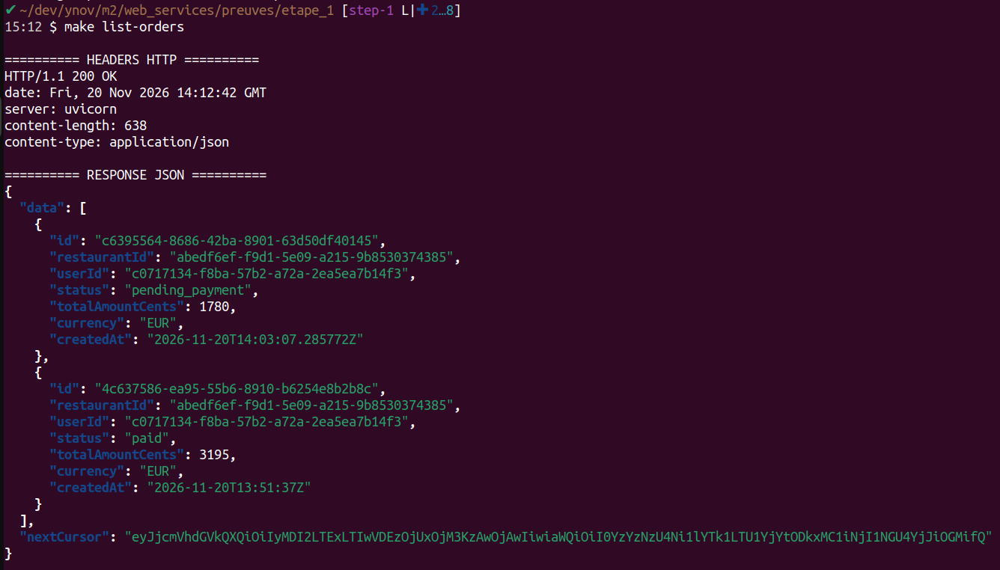
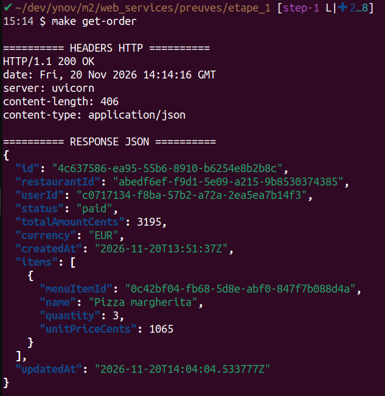
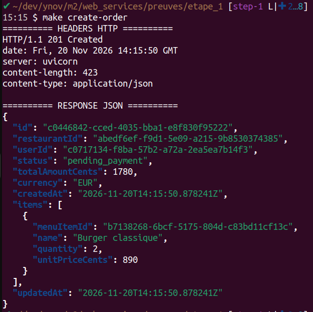
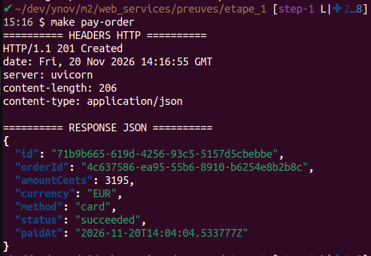
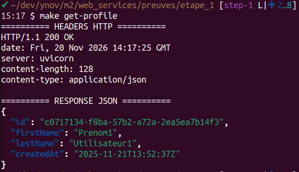

# Preuves - Etape 1

Ce dossier contient les preuves des cinq routes de l'API Miamzy ainsi qu'un
`Makefile` permettant de rejouer facilement chaque appel.

## Verification avec Make

Depuis ce dossier :

```bash
make help
make check
make list-orders
make get-order
make create-order
make pay-order
make get-profile
```

## Identifiants de demonstration

```text
Restaurant ouvert : abedf6ef-f9d1-5e09-a215-9b8530374385
Article disponible : b7138268-6bcf-5175-804d-c83bd11cf13c
Utilisateur         : c0717134-f8ba-57b2-a72a-2ea5ea7b14f3
Commande            : 4c637586-ea95-55b6-8910-b6254e8b2b8c
```

## Captures

### Lister les commandes



```http
HTTP/1.1 200 OK
content-type: application/json

{
  "data": [
    {
      "id": "c6395564-8686-42ba-8901-63d50df40145",
      "restaurantId": "abedf6ef-f9d1-5e09-a215-9b8530374385",
      "userId": "c0717134-f8ba-57b2-a72a-2ea5ea7b14f3",
      "status": "pending_payment",
      "totalAmountCents": 1780,
      "currency": "EUR",
      "createdAt": "2026-11-20T14:03:07.285772Z"
    },
    {
      "id": "4c637586-ea95-55b6-8910-b6254e8b2b8c",
      "restaurantId": "abedf6ef-f9d1-5e09-a215-9b8530374385",
      "userId": "c0717134-f8ba-57b2-a72a-2ea5ea7b14f3",
      "status": "paid",
      "totalAmountCents": 3195,
      "currency": "EUR",
      "createdAt": "2026-11-20T13:51:37Z"
    }
  ],
  "nextCursor": "eyJjcmVhdGVkQXQiOiIyMDI2LTExLTIwVDEzOjUxOjM3WiJ9"
}
```

### Consulter une commande



```http
HTTP/1.1 200 OK
content-type: application/json

{
  "id": "4c637586-ea95-55b6-8910-b6254e8b2b8c",
  "restaurantId": "abedf6ef-f9d1-5e09-a215-9b8530374385",
  "userId": "c0717134-f8ba-57b2-a72a-2ea5ea7b14f3",
  "status": "paid",
  "totalAmountCents": 3195,
  "currency": "EUR",
  "createdAt": "2026-11-20T13:51:37Z",
  "items": [
    {
      "menuItemId": "0c42bf04-fb68-5d8e-abf0-847f7b088d4a",
      "name": "Pizza margherita",
      "quantity": 3,
      "unitPriceCents": 1065
    }
  ],
  "updatedAt": "2026-11-20T14:04:04.533777Z"
}
```

### Creer une commande



```http
HTTP/1.1 201 Created
content-type: application/json

{
  "id": "c0446842-cced-4035-bba1-e8f830f95222",
  "restaurantId": "abedf6ef-f9d1-5e09-a215-9b8530374385",
  "userId": "c0717134-f8ba-57b2-a72a-2ea5ea7b14f3",
  "status": "pending_payment",
  "totalAmountCents": 1780,
  "currency": "EUR",
  "createdAt": "2026-11-20T14:15:50.878241Z",
  "items": [
    {
      "menuItemId": "b7138268-6bcf-5175-804d-c83bd11cf13c",
      "name": "Burger classique",
      "quantity": 2,
      "unitPriceCents": 890
    }
  ],
  "updatedAt": "2026-11-20T14:15:50.878241Z"
}
```

### Payer une commande



```http
HTTP/1.1 201 Created
content-type: application/json

{
  "id": "71b9b665-619d-4256-93c5-5157d5cbebbe",
  "orderId": "4c637586-ea95-55b6-8910-b6254e8b2b8c",
  "amountCents": 3195,
  "currency": "EUR",
  "method": "card",
  "status": "succeeded",
  "paidAt": "2026-11-20T14:04:04.533777Z"
}
```

Relancer `make pay-order` avec la meme cle renvoie le meme paiement sans en
creer un second. Rejouer le seed remet la commande dans l'etat
`pending_payment`.

### Consulter un profil



```http
HTTP/1.1 200 OK
content-type: application/json

{
  "id": "c0717134-f8ba-57b2-a72a-2ea5ea7b14f3",
  "firstName": "Prenom1",
  "lastName": "Utilisateur1",
  "createdAt": "2025-11-21T13:52:37Z"
}
```

La documentation interactive FastAPI est disponible sur
`http://localhost:8000/docs`.
