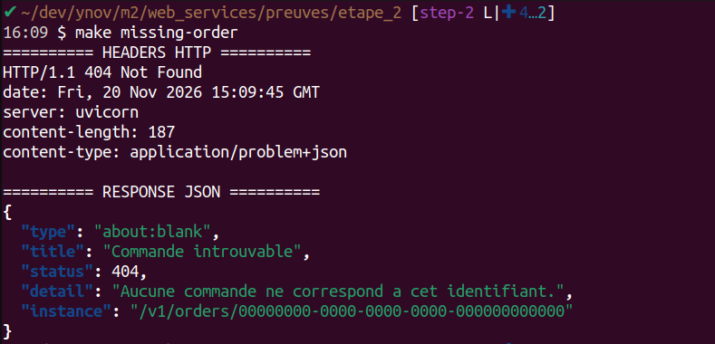
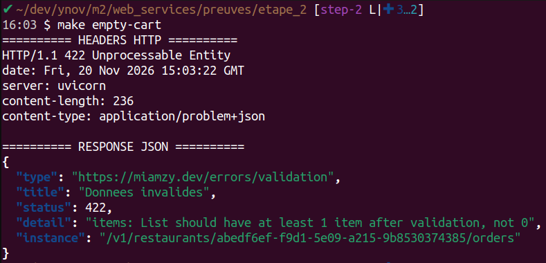
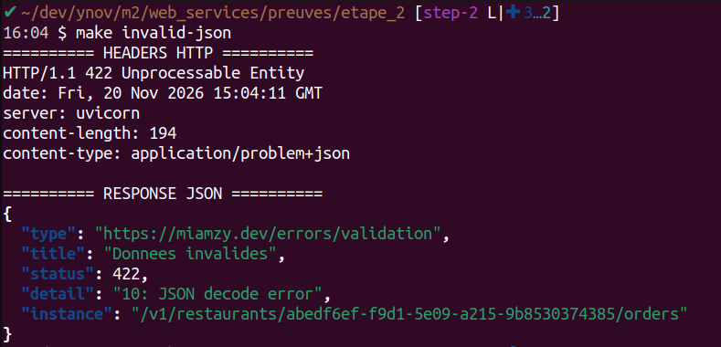

# Preuves - Etape 2

Ce dossier regroupe les trois erreurs demandees pour l'etape 2. Elles utilisent
toutes le type de contenu `application/problem+json` et exactement les memes
champs : `type`, `title`, `status`, `detail` et `instance`.

## Verification avec Make

L'API et PostgreSQL doivent etre demarres. Depuis ce dossier :

```bash
make check
make missing-order
make empty-cart
make invalid-json
```

`make check` controle automatiquement les codes HTTP et la forme des trois
reponses. Les trois autres commandes affichent les en-tetes et le JSON pour
realiser les captures.

## Captures

### Commande inexistante - 404

Commande : `make missing-order`



```http
HTTP/1.1 404 Not Found
content-type: application/problem+json

{
  "type": "about:blank",
  "title": "Commande introuvable",
  "status": 404,
  "detail": "Aucune commande ne correspond a cet identifiant.",
  "instance": "/v1/orders/00000000-0000-0000-0000-000000000000"
}
```

### Panier vide - 422

Commande : `make empty-cart`



```http
HTTP/1.1 422 Unprocessable Entity
content-type: application/problem+json

{
  "type": "https://miamzy.dev/errors/validation",
  "title": "Donnees invalides",
  "status": 422,
  "detail": "items: List should have at least 1 item after validation, not 0",
  "instance": "/v1/restaurants/abedf6ef-f9d1-5e09-a215-9b8530374385/orders"
}
```

Le champ `detail` identifie le champ `items` et indique qu'il doit contenir au
moins un article.

### JSON illisible - 422

Commande : `make invalid-json`



```http
HTTP/1.1 422 Unprocessable Entity
content-type: application/problem+json

{
  "type": "https://miamzy.dev/errors/validation",
  "title": "Donnees invalides",
  "status": 422,
  "detail": "10: JSON decode error",
  "instance": "/v1/restaurants/abedf6ef-f9d1-5e09-a215-9b8530374385/orders"
}
```

Cette erreur reste une erreur client 4xx et ne provoque jamais de reponse 500.
