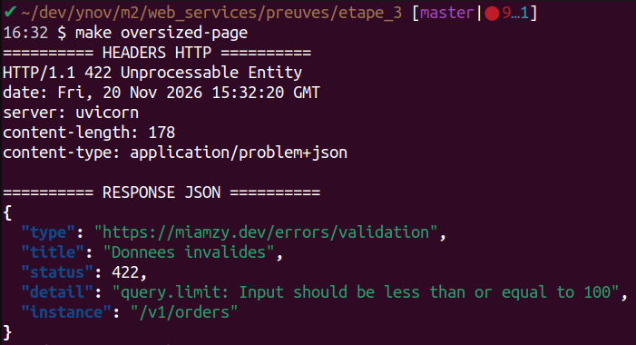

# Preuves - Etape 3

La liste des commandes utilise une pagination par curseur avec 20 elements par
defaut et un maximum de 100. Une limite superieure est refusee avec une erreur
`422` afin de ne jamais lancer une lecture non bornee.

## Verification avec Make

L'API et PostgreSQL doivent etre demarres. Depuis ce dossier :

```bash
make check
make default-page
make next-page
make oversized-page
make explain
```

`make check` controle le nombre d'elements des deux premieres pages, l'absence
de doublons entre elles, la limite de 100 et le refus d'une limite de 100 000.

## Capture demandee

Executer `make oversized-page` puis capturer le terminal. La reponse attendue
est une erreur `422 application/problem+json` dont le detail indique que
`query.limit` doit etre inferieur ou egal a 100. Aucun tableau de commandes
n'est renvoye.

Sortie obtenue avec `make oversized-page` :



```http
HTTP/1.1 422 Unprocessable Entity
content-type: application/problem+json

{
  "type": "https://miamzy.dev/errors/validation",
  "title": "Donnees invalides",
  "status": 422,
  "detail": "query.limit: Input should be less than or equal to 100",
  "instance": "/v1/orders"
}
```

`make next-page` a egalement renvoye deux pages distinctes contenant chacune
20 commandes et deux curseurs successifs.

## Requete bornee

Pour une page obtenue apres un curseur, SQLAlchemy envoie une requete equivalente
a celle-ci :

```sql
SELECT orders.id, orders.restaurant_id, orders.user_id, orders.status,
       orders.total_amount_cents, orders.currency, orders.created_at,
       orders.updated_at
FROM orders
WHERE (orders.created_at, orders.id) < (:cursor_created_at, :cursor_id)
ORDER BY orders.created_at DESC, orders.id DESC
LIMIT :limit_plus_one;
```

Pour une page de 20 commandes, `limit_plus_one` vaut 21. La ligne supplementaire
sert uniquement a detecter l'existence de la page suivante; elle n'est jamais
exposee au client.

L'index utilise le meme ordre que le filtre et le tri :

```sql
CREATE INDEX ix_orders_created_at_id_desc
ON orders (created_at DESC, id DESC);
```

`make explain` affiche le plan reel de PostgreSQL pour verifier le `LIMIT` et
l'utilisation de cet index.

Extrait du plan obtenu sur la base contenant plus de 5 000 commandes :

```text
Limit  (actual rows=21 loops=1)
  -> Index Scan using ix_orders_created_at_id_desc on orders
     (actual rows=21 loops=1)
```
